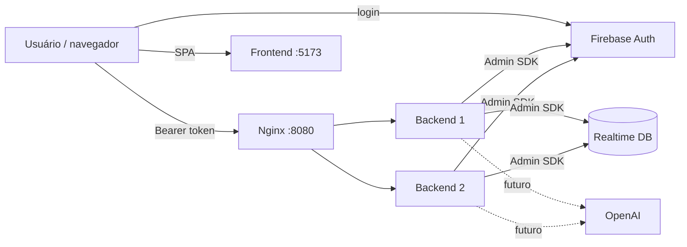

# Relatório Técnico — AppSec & SRE: CourseSphere

> Data: 28/10/2026 · Autor: Ryan Medeiros · Repositório: `Ryanmedeirosp/CourseSphere` (fork de `LambdaAK/CourseSphere`)
>
> Pontos marcados com **⚠️ PREENCHER** dependem de evidência coletada na máquina do autor. Antes de entregar, rode:
> `Select-String -Path SECURITY_REPORT.md,README.md -Pattern "PREENCHER"` — o resultado deve ser vazio.

## 1. Resumo executivo (para gestão)

A aplicação analisada é um chatbot que recomenda cursos (Flask + React + Firebase). Foram identificados **12 achados**: 7 reproduzidos de forma controlada (V1–V5, V8, V9), 4 confirmados por leitura de código ou por ferramenta (V6, V7, V10, V11) e 1 risco não validado (V12). Nenhum dos achados confirmados dá, por si só, acesso aos dados de outros usuários (pela leitura do código, o isolamento de chats por `uid` parece correto, mas não foi testado contra o banco real), porém vários expõem informações internas, facilitam abuso ou ampliam o impacto de um incidente.

| Situação | Quantidade | Itens |
|---|---|---|
| Corrigidos | 6 | V1, V2, V3, V4, V8 (cada um com teste automatizado) e V11 (verificável com `git status`) |
| Mitigados parcialmente | 2 | V9 (rate limit por instância), V10 (24 → ⚠️ PREENCHER vulnerabilidades no frontend) |
| **Abertos** | 4 | V5 (política de senha), V6 (segredo no repositório), V7 (SQL injection latente), V12 (regras do banco não verificáveis) |

**O que precisa de ação imediata da equipe:** revogar a credencial do Reddit commitada no repositório (V6). Não foi possível validá-la, por ser de terceiros, mas o risco é alto se estiver ativa.

**Disponibilidade:** a solução ganhou balanceamento entre 2 instâncias, `/health`, métricas Prometheus e logs JSON. Os maiores riscos de disponibilidade que permanecem são o Nginx único (ponto único de falha), a ausência de TLS e a dependência total do Firebase (ver seção 8).

## 2. Escopo

- **Em escopo:** código do repositório (`backend/`, `frontend/`), configuração de containers e a API executada **localmente** (Flask + emulador do Firebase).
- **Fora de escopo:** o projeto Firebase real usado pelo `firebaseConfig.ts` original (terceiro — **não foi testado**), a API do Reddit, a OpenAI e qualquer infraestrutura em nuvem.
- **Ambiente de teste:** Firebase Emulator Suite (projeto fictício `demo-coursesphere`), Python 3.14 (local) / 3.12 (container), Docker 27.2.0 / Compose v2.29.2 (Docker Desktop, Windows).

## 3. Metodologia

1. **Leitura manual do código** (rotas, autenticação, tratamento de erros, configuração).
2. **SAST:** Bandit. **SCA:** `pip-audit` (backend) e `npm audit` (frontend). Resultados em `docs/evidence/`.
3. **Reprodução controlada** de cada achado contra a versão vulnerável (tag `vulneravel`), com `curl` e testes automatizados.
4. **Correção em commits pequenos**, cada um com teste que **falha antes e passa depois** (história: 8 falhas/1 passa → 23 testes passando).
5. Classificação por **gravidade qualitativa** (Alta/Média/Baixa) considerando probabilidade e impacto no contexto real, com referência a OWASP Top 10 (2021) e CWE. Não foi calculado CVSS numérico.

## 4. Achados

| ID | Achado | OWASP / CWE | Gravidade | Estado |
|---|---|---|---|---|
| V1 | `id_token` na URL (vai para logs de acesso) | A09 · CWE-598, CWE-532 | **Média** | Reproduzido · **Corrigido** |
| V2 | Mensagens de erro expõem detalhes internos | A05 · CWE-209 | **Baixa** | Reproduzido · **Corrigido** |
| V3 | Depurador Werkzeug ativo (`debug=True`) | A05 · CWE-489 | **Média** (Alta se exposto em rede) | Reproduzido · **Corrigido** |
| V4 | CORS aberto a qualquer origem (`*`) | A05 · CWE-942 | **Baixa** | Reproduzido · **Corrigido** |
| V5 | Senha `123456` aceita; sem política de senha | A07 · CWE-521 | **Média** | Reproduzido · **Aberto** (mitigado por rate limit) |
| V6 | `client_secret` do Reddit commitado | A07 · CWE-798 | **Alta** (não validada) | Confirmado por leitura · **Aberto** |
| V7 | SQL injection por f-string em `blueprints/courses.py` | A03 · CWE-89 | **Alta se ativada; hoje não explorável** | Confirmado por leitura · **Aberto (latente)** |
| V8 | Headers de segurança ausentes e banner `Server: Werkzeug/Python` | A05 · CWE-693 | **Baixa** | Reproduzido · **Corrigido** |
| V9 | Sem rate limiting (criação de contas em massa, abuso do chatbot) | A04 · CWE-770 | **Média** | Reproduzido por teste · **Parcial** |
| V10 | 24 vulnerabilidades em dependências do frontend (2 críticas) | A06 · CWE-1104 | **Média** (alcance no bundle não encontrado) | Confirmado · **Parcial** |
| V11 | `.gitignore` não cobria `credentials.json` nem `.venv/` | A05 | **Baixa** | Confirmado · **Corrigido** |
| V12 | Regras do Realtime Database não estão no repositório | A01 / A05 | **Não classificado** | Risco não validado |

### Categorias OWASP cobertas
Configuração incorreta de segurança (V3, V4, V8, V11), exposição de dados sensíveis (V1, V2, V6), autenticação/sessão (V5, V9), injeção (V7, latente) e dependências vulneráveis (V10).

### V1 — `id_token` na query string
- **Onde:** `backend/endpoints.py`, rota `GET /users/info` lia `request.args.get("id_token")`.
- **Reprodução (versão vulnerável):** com o emulador e o backend rodando, criar um usuário, fazer login no emulador e chamar `GET /users/info?id_token=<token>`. A linha do log de acesso do servidor registra o JWT inteiro: `"GET /users/info?id_token=eyJhbGciOi... HTTP/1.1" 200`.
- **Impacto no negócio:** quem tiver acesso a logs, proxies ou histórico do navegador obtém um token válido (1 h no Firebase) e age em nome do usuário.
- **Causa-raiz:** o contrato da API colocava um segredo de sessão na URL, que é gravada por design em vários lugares.
- **Correção:** a rota exige `Authorization: Bearer <token>`; token na URL passa a retornar `401`. O frontend (`api.ts`) foi ajustado. Token inválido/expirado devolve `401` sem texto do SDK.
- **Prova:** `tests/test_security.py::test_user_info_rejeita_token_na_query_string` e `::test_user_info_aceita_token_no_header_authorization`; manual: `query: 401`, `header: 200`.
- **Limite:** `POST /users/info` e `/users/query` ainda recebem o token no **corpo** (não vai para o log de acesso). Melhoria recomendada.

### V2 — Erros que vazam detalhes internos
- **Onde:** todas as rotas faziam `except Exception as e: return ... str(e)`.
- **Reprodução:** com o emulador **parado**, `POST /users/create` devolvia: `{"error": "Error creating user: Error creating user: Failed to establish a connection: HTTPConnectionPool(host='127.0.0.1', port=9099): Max retries exceeded with url: /identitytoolkit.googleapis.com/v1/projects/demo-coursesphere/accounts ..."}` — host, porta, caminho da API e ID do projeto.
- **Impacto:** reconhecimento da topologia interna por um atacante. Gravidade baixa isolada, mas amplia outros ataques.
- **Causa-raiz:** exceções internas eram repassadas ao cliente sem filtro.
- **Correção:** erros esperados viram `PublicError` (mensagem segura, status 400/401); o resto vira `500 {"error": "Internal server error"}` e o detalhe vai **só para o log** (com stack trace, em JSON).
- **Prova:** `test_erro_interno_nao_vaza_detalhes_ao_cliente`, `test_email_ja_cadastrado_continua_com_mensagem_util`, `test_token_invalido_retorna_401_sem_detalhes`.
- **Evidência depois:** ⚠️ PREENCHER — cole aqui a saída de `curl.exe -s -i -X POST http://localhost:8080/users/create ...` (deve mostrar `500` e `Internal server error`).

### V3 — Depurador Werkzeug ativo
- **Onde:** `app.run(debug=True)` em `endpoints.py`.
- **Reprodução:** ao subir o servidor aparece `Debug mode: on` e `Debugger PIN: 835-963-058`; `GET /console` retorna **200**.
- **Impacto:** o console interativo permite executar código Python no servidor a quem obtiver o PIN. Com o servidor em `127.0.0.1` o risco é local; quando o app escuta em `0.0.0.0` (caso de containers) torna-se crítico — por isso a gravidade é "Média, Alta se exposto".
- **Causa-raiz:** configuração de desenvolvimento fixa no código.
- **Correção:** `debug` só liga com `FLASK_DEBUG=1`; host por `HOST` (padrão `127.0.0.1`); em produção o app roda sob Gunicorn.
- **Prova:** `test_debug_desligado_por_padrao`, `test_debug_so_liga_com_variavel_explicita`; manual: `/console → 404`.

### V4 — CORS aberto
- **Onde:** `CORS(app)` sem origens.
- **Reprodução:** respostas trazem `Access-Control-Allow-Origin: *`; uma preflight `OPTIONS` com `Origin: https://site-malicioso.example` é aceita.
- **Impacto:** qualquer site pode chamar a API a partir do navegador do usuário. **Atenuante:** a API usa token em header (não cookies), então o navegador não anexa credenciais sozinho — por isso a gravidade é baixa.
- **Correção:** `CORS(app, origins=ALLOWED_ORIGINS)`, com padrão `localhost:5173` e `127.0.0.1:5173`, configurável por `CORS_ORIGINS`.
- **Prova:** `test_cors_nao_aceita_origem_desconhecida`, `test_cors_aceita_origem_do_frontend`; manual: origem maliciosa sem header, `localhost:5173` aceita.

### V5 — Política de senha fraca (aberto)
- **Reprodução:** `POST /users/create` com `{"password":"123456"}` retorna `200`.
- **Impacto:** contas fáceis de adivinhar; combinado com ausência de MFA facilita *credential stuffing*.
- **Estado:** **não corrigido no código.** A senha é validada pelo Firebase (mínimo de 6 caracteres). A correção correta é configurar a política de senha no Firebase Console (tamanho mínimo maior, complexidade) e/ou validar no backend. Mitigação parcial: rate limit em `/users/create` (V9). O login em si **não passa pelo nosso backend** e portanto o controle de força bruta no login é do Firebase (não testado).

### V6 — Segredo commitado (aberto)
- **Onde:** `backend/cornell-course-sphere-data/reddit-data/reddit_key.json` (chaves `client_id` e `client_secret`).
- **Evidência:** presença do arquivo e das chaves no repositório; os valores **não** são reproduzidos neste relatório.
- **Validação:** a credencial **não foi testada** contra o Reddit por ser de terceiros (fora do escopo autorizado). A gravidade "Alta" assume que ela esteja ativa.
- **Ação recomendada:** (1) revogar/rotacionar a credencial no Reddit; (2) remover o arquivo do repositório e do histórico (`git filter-repo`, com cuidado: reescreve histórico); (3) `.gitignore` já impede novos commits do arquivo (V11), mas **não o remove** do histórico.

### V7 — SQL injection latente (aberto)
- **Onde:** `backend/blueprints/courses.py`. Três rotas interpolam texto livre em SQL: `/courses/<string:semester>`, `<string:department>`, `<string:instructor>` (`f"... WHERE semester = '{semester}'"`). As três rotas com `<int:...>` não são injetáveis (o Flask só aceita dígitos) — o Bandit (B608, 6 ocorrências) as marca por padrão de código, mas na prática são falsos positivos.
- **Por que é "latente":** `#app.register_blueprint(courses_bp)` está **comentado** em `endpoints.py`, e `db.py` aponta para um caminho de banco com erro de digitação. Hoje a rota não é alcançável. **Não foi reproduzida.**
- **Impacto se ativada:** leitura e alteração arbitrária do banco por qualquer cliente (Alta).
- **Correção recomendada (não aplicada):** consultas parametrizadas (`execute_query("... WHERE semester = ?", (semester,))`) **antes** de registrar o blueprint. Observação: as três rotas `<string:...>` têm o **mesmo padrão de URL**, então só a primeira registrada responderia — bug funcional a corrigir junto.

### V8 — Headers de segurança ausentes
- **Reprodução:** respostas sem `X-Content-Type-Options`, `X-Frame-Options`, CSP etc., e com `Server: Werkzeug/3.1.9 Python/3.14.5`.
- **Correção:** `after_request` adiciona `nosniff`, `X-Frame-Options: DENY`, `Referrer-Policy: no-referrer`, `Content-Security-Policy: default-src 'none'; frame-ancestors 'none'`, `Cache-Control: no-store` e HSTS (apenas quando a conexão é HTTPS). O Nginx remove a versão do servidor (`Server: nginx`).
- **Prova:** `tests/test_hardening.py::test_resposta_tem_headers_de_seguranca`, `::test_hsts_so_e_enviado_quando_a_conexao_e_https`.
- **Limite:** protege as respostas da **API**. O frontend tem só 3 headers básicos no seu Nginx; falta CSP e HSTS (sem TLS).

### V9 — Sem rate limiting
- **Reprodução:** 7 chamadas seguidas a `POST /users/create` retornavam todas `200` (sem bloqueio) — teste `test_rate_limit_bloqueia_criacao_de_contas_em_massa`, que falhava antes da correção.
- **Correção:** Flask-Limiter: 5/min em `/users/create`, 20/min em `/users/query`, 60/min em `/hash`, teto de 200/min por IP; resposta `429` em JSON.
- **Medição (teste local com 2 instâncias Gunicorn atrás do Nginx; ⚠️ PREENCHER: repita no compose com o comando do guia e confirme):** 12 chamadas seguidas deram `500` ×10 e só então `429` — o limite é **por instância**, não global. O IP forjado em `X-Forwarded-For` **não** burla o limite, porque o Nginx sobrescreve o header e o backend só confia nele com `TRUST_PROXY=1`.
- **Limite:** contador em memória. Solução definitiva: Redis compartilhado (`RATELIMIT_STORAGE_URI`).

### V10 — Dependências vulneráveis (frontend)
- **Evidência (antes):** `npm audit --omit=dev` → **24 vulnerabilidades (13 moderadas, 9 altas, 2 críticas)** (`docs/evidence/audit-frontend.txt`).
- **As 2 críticas:** `protobufjs` (via `firebase → @firebase/firestore`) e `websocket-driver` (via `firebase → @firebase/database → faye-websocket`). O frontend importa só `firebase/app`, `firebase/auth` e `firebase/database`; uma busca por texto no bundle de 1,1 MB não encontrou `protobuf`, `websocket-driver`, `faye`, `undici` nem `@grpc`. É um forte indício de que não chegam ao navegador, **mas não é prova**.
- **Correção:** `npm audit fix` (sem `--force`): `firebase` 10.12.3 → 10.14.1, sem mudar `package.json`. Resultado: ⚠️ PREENCHER (`docs/evidence/audit-frontend-depois.txt`; na simulação: 14 — 9 moderadas, 5 altas, 0 críticas).
- **Residual:** `@grpc/grpc-js` e `undici` (altas), `react-router` e `uuid` (moderadas) exigiriam atualizar o `firebase` para outra versão principal.
- **Backend:** `pip-audit` — *No known vulnerabilities found* (`docs/evidence/audit-backend.txt`). As dependências Python **não têm versões fixadas**, então o resultado vale para o dia da execução.

### V11 — `.gitignore` insuficiente
`credentials.json`, `.env`, `.venv/` e `__pycache__/` não estavam ignorados (o `.venv` já aparece no histórico do projeto original). Corrigido; não remove o que já está no histórico.

### V12 — Regras do Realtime Database
O frontend fala direto com o banco, e as regras de segurança **não estão no repositório**; portanto não é possível afirmar se o projeto original está protegido. Foi adicionado `database.rules.json` restritivo (cada usuário lê/escreve só em `users/<uid>`), usado no emulador. **Não foi testado por teste automatizado** — recomendação: testar com `@firebase/rules-unit-testing`.

### O que foi verificado e **não** é vulnerabilidade
- **Isolamento de chats:** o `uid` vem do token verificado no servidor, nunca do cliente — não há IDOR/BOLA aparente nas rotas de chat.
- **`apiKey` do Firebase no frontend:** é pública por design; o risco está nas regras do banco e nas restrições da chave.
- **Alertas B311/B101 do Bandit:** `random` é usado só para compor um ID de mensagem (que também usa `secrets.token_hex`); `assert` com impacto baixo.

## 5. Resultados de SAST/SCA

| Ferramenta | Resultado | Arquivo |
|---|---|---|
| Bandit (SAST) | **Antes:** 11 alertas — 1 Alta (B201 debug), 6 Média (B608 SQL), 4 Baixa (452 linhas). **Depois:** 10 alertas — 0 Alta, 6 Média (os mesmos B608 da V7, ainda abertos), 4 Baixa | `docs/evidence/bandit.txt` (antes) e `docs/evidence/bandit-depois.txt` (depois) |
| pip-audit (SCA backend) | Nenhuma vulnerabilidade conhecida | `docs/evidence/audit-backend.txt` |
| npm audit (SCA frontend) | 24 → ⚠️ PREENCHER | `docs/evidence/audit-frontend*.txt` |
| CI (GitHub Actions) | Roda testes, Bandit, pip-audit e npm audit a cada push (ver `.github/workflows/ci.yml`); **não executado até o envio ao GitHub** | — |

O Bandit marcou como "Alta" o `debug=True` e não viu V1, V2, V4, V6, V9 — SAST sozinho não basta; a análise manual foi decisiva.

## 6. Recomendações priorizadas

| # | Ação | Por quê | Esforço |
|---|---|---|---|
| 1 | Revogar o segredo do Reddit e limpar o histórico (V6) | Credencial exposta publicamente | Baixo (revogar) / Médio (histórico) |
| 2 | Parametrizar as consultas SQL antes de registrar o blueprint (V7) | Evita injeção na ativação | Baixo |
| 3 | Revisar/aplicar regras do Realtime Database e testá-las (V12) | O banco é acessado direto do navegador | Médio |
| 4 | Política de senha forte e MFA no Firebase (V5) | Contas fracas | Baixo |
| 5 | Rate limit compartilhado (Redis) e TLS (V9) | Limite real e proteção em trânsito | Médio |
| 6 | Atualizar `firebase` para versão principal corrente (V10) | Zerar críticas/altas restantes | Médio (risco de regressão) |
| 7 | Fixar versões Python (lockfile) e corrigir os 15 erros de TypeScript | Reprodutibilidade e build do frontend | Médio |
| 8 | Restringir a `apiKey` do Firebase por domínio e ativar App Check | Reduz abuso do projeto | Baixo |

## 7. Infraestrutura entregue

- `backend/Dockerfile`: Python 3.12, usuário sem privilégios, Gunicorn (1 worker, 4 threads), `HEALTHCHECK`.
- `frontend/Dockerfile`: build em 2 etapas (Node → Nginx sem root). O script `npm run build` **já falhava** com 15 erros de TypeScript no projeto original, então a imagem usa `vite build` direto.
- `docker-compose.yml`: Nginx (porta 8080) → `backend1` e `backend2`; frontend na 5173; `cap_drop: ALL`, `no-new-privileges`, limites de memória/CPU; **só Nginx e frontend publicam portas**.
- **Evidência de balanceamento:** ⚠️ PREENCHER — cole o resultado de `docker compose logs nginx --tail 12` (linhas `upstream=` alternando entre dois IPs).

## 8. Confiabilidade (SRE)

### 8.1 Instrumentação disponível
- **Logs JSON** (stdout): `ts`, `level`, `request_id`, `method`, `path` (sem query string), `endpoint`, `status`, `duration_ms`; eventos `auth_failed`, `user_created`, `rate_limited`; erros com stack trace.
- **`X-Request-ID`:** gerado pelo Nginx e propagado ao backend; o mesmo ID aparece no log do Nginx e no log JSON (validado em teste local).
- **`GET /health`:** liveness (processo responde; isento de rate limit).
- **`GET /metrics`:** formato Prometheus — `http_requests_total{method,endpoint,status}` e `http_request_duration_seconds{endpoint}`. **Não exposto ao público** (Nginx devolve 404); o Prometheus deve coletar direto dos backends.

### 8.2 SLIs e SLOs (propostas iniciais — **não são medições**)

| SLI | Definição (PromQL) | SLO proposto | Justificativa |
|---|---|---|---|
| **Disponibilidade da API** | `sum(rate(http_requests_total{status!~"5..",endpoint!~"/health\|/metrics"}[5m])) / sum(rate(http_requests_total{endpoint!~"/health\|/metrics"}[5m]))` | ≥ **99,5 %** em 30 dias (orçamento de erro de 0,5 %) | Serviço sem requisito de missão crítica; 429 conta como "bom" por ser controle deliberado |
| **Latência** | `sum(rate(http_request_duration_seconds_bucket{le="0.5",endpoint!~"/health\|/metrics"}[5m])) / sum(rate(http_request_duration_seconds_count{endpoint!~"/health\|/metrics"}[5m]))` | **95 %** das requisições < 500 ms em 30 dias | CRUD simples dependente do Firebase; o chatbot (OpenAI) deverá ter SLO próprio |

O login ocorre no Firebase, fora do backend, portanto **não é medido** aqui; usamos `/users/create` e `/users/info` como proxies de CRUD.

### 8.3 Dashboard (descrição; não implementado)
Grafana com fonte Prometheus (scrape de `backend1:5000/metrics` e `backend2:5000/metrics`):
1. **Disponibilidade (stat):** SLI de disponibilidade, com limiar 99,5 %.
2. **Taxa de erro 5xx por endpoint** (time series).
3. **Latência p50/p95/p99:** `histogram_quantile(0.95, sum by (le) (rate(http_request_duration_seconds_bucket[5m])))`.
4. **Requisições por segundo por instância** — confirma o balanceamento.
5. **Taxa de 429** — sinal de abuso.
6. **Instâncias no ar:** `up{job="backend"}`.
7. **Eventos de segurança** (Loki sobre os logs JSON): `auth_failed` por minuto.

Alertas sugeridos: erro 5xx > 2 % por 5 min; p95 > 500 ms por 10 min; `up == 0` por 1 min; pico de `auth_failed`.

### 8.4 Riscos de disponibilidade
| Risco | Impacto | Mitigação recomendada |
|---|---|---|
| Nginx único (SPOF) | Queda total se cair | 2+ balanceadores ou LB gerenciado de nuvem |
| Sem TLS | Tráfego em claro; sem HSTS | Certificado (Let's Encrypt/ACM) no balanceador |
| Dependência do Firebase (Auth e RTDB) | Indisponibilidade externa derruba login e dados | Timeouts, retries com *backoff*, circuit breaker, mensagem degradada |
| Healthcheck só de liveness | Instância "viva" mas sem acesso ao Firebase continua recebendo tráfego | Endpoint de readiness que verifique dependências |
| Capacidade baixa (1 worker × 4 threads) | Saturação sob carga | Teste de carga (k6/Locust), ajustar workers, autoscaling |
| Rate limit por instância | Limite efetivo × nº de instâncias | Redis compartilhado |
| Dependências Python sem versão fixa | Build não reproduzível; falha inesperada | Lockfile / `pip-compile` |
| Sem backup/restore documentado do banco | Perda de dados em incidente | Exportações agendadas do RTDB |

## 9. Modelagem de ameaças (STRIDE, resumida)

Fronteiras de confiança: navegador ↔ Nginx; Nginx ↔ backends (rede interna); backends ↔ serviços externos.

| Ameaça | Exemplo no sistema | Controle atual |
|---|---|---|
| **S**poofing | Forjar token ou IP | Verificação de token no servidor; Nginx sobrescreve `X-Forwarded-For` |
| **T**ampering | Alterar dados de outro usuário | `uid` extraído do token; regras do RTDB (não validadas no projeto real) |
| **R**epudiation | Negar ações | Logs JSON com `request_id` e eventos de autenticação |
| **I**nformation disclosure | Erros verbosos, token em log | V1 e V2 corrigidos; `/metrics` interno |
| **D**enial of service | Criação de contas/consultas em massa | Rate limit; limites de memória/CPU; ainda sem proteção volumétrica |
| **E**levation of privilege | Debugger, SQL injection | V3 corrigido; V7 latente |

## 10. Riscos residuais e limitações

- V5, V6, V7 e V12 permanecem abertos (ver seção 4).
- Nada foi testado contra o projeto Firebase real do `firebaseConfig.ts`.
- O compose **não inclui o emulador do Firebase**: rotas que dependem do Firebase respondem `500` genérico dentro dele. O fluxo completo (login → API) foi exercitado em modo local, com o emulador no host.
- O frontend em container usa o Firebase original no login; os testes de ponta a ponta com o navegador **não foram realizados**.
- A suíte de testes cobre o backend; não há testes automatizados do frontend.
- Valores de SLO são propostas, não medições.
